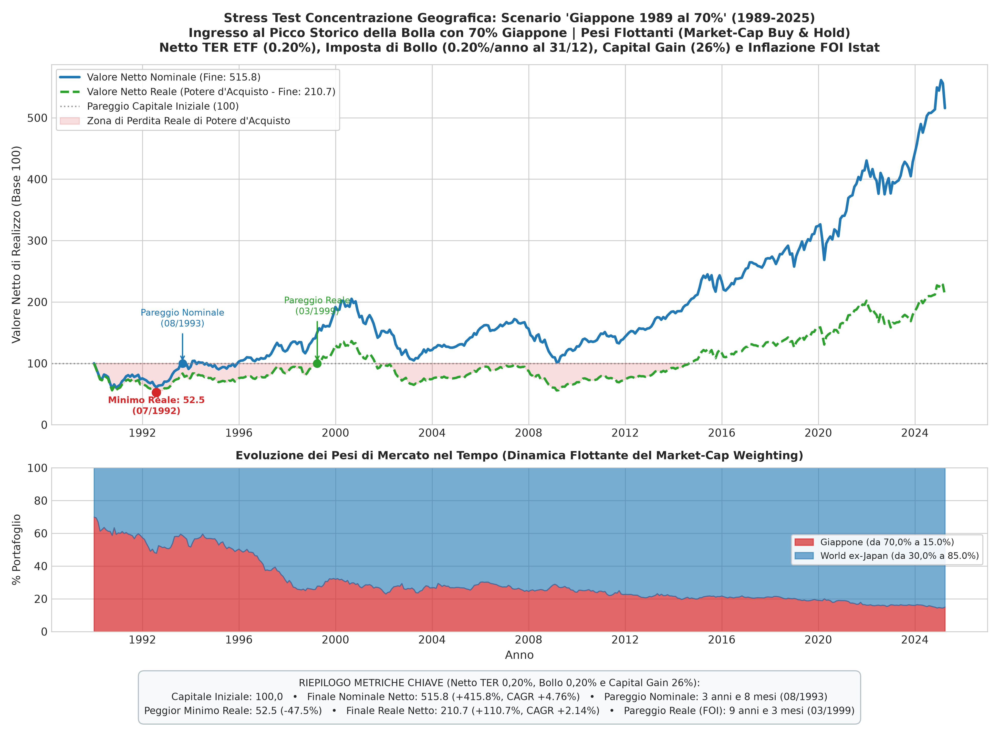

# Italian Investor Benchmark: Simulatore Quantitativo per l'Investitore Italiano

> ⚠️ **DISCLAIMER**: Questo progetto nasce esclusivamente per **scopo didattico, di ricerca e curiosità personale**.  
> **Non sono un consulente finanziario** e nessuna informazione, dato, metrica, codice o tabella presente in questo repository costituisce o intende costituire una consulenza finanziaria, un consiglio di investimento o una sollecitazione al pubblico risparmio.  
> Investire sui mercati finanziari comporta il rischio concreto di perdita totale o parziale del capitale. L'autore declina espressamente ogni responsabilità per qualsiasi decisione o perdita economica derivante dall'uso o dall'interpretazione dei dati e del codice qui contenuti. I rendimenti passati non sono in alcun modo garanzia di rendimenti futuri.

---

Simulatore quantitativo e motore di analisi storica in Python (2000–2025, 292 mesi) calibrato sulla **realtà fiscale e contabile dell'investitore residente in Italia**:

1. **Esperimento 1 (`main.py`) — Analisi a Finestre Mobili su 3 Strategie ETF Globali**:
   - **MSCI World (SWDA)**: Sviluppati Large & Mid Cap (~23 paesi, TER 0,20%).
   - **FTSE ALL WORLD (tramite proxy MSCI ACWI) (VWCE)**: Sviluppati + Emergenti Large & Mid Cap (~47 paesi, TER 0,14%).
   - **FTSE GLOBAL ALL CAP (tramite proxy MSCI ACWI IMI) (VALL)**: Sviluppati + Emergenti + Small Cap (~99% del mercato, TER 0,07%).
2. **Esperimento 2 (`main_bank_fund.py`) — Voragine dei Costi: ETF Passivo vs Fondo Bancario Attivo**:
   - Confronto contabile (Base 100) e a finestre mobili tra un **ETF passivo (TER 0,20%)** e un tipico **fondo comune attivo di sportello bancario (TER 2,00%)** sullo stesso sottostante (MSCI World).
3. **Esperimento 3 (`main_japan_stress_test.py`) — Stress Test Concentrazione Geografica: "Giappone 1989 al 70%" (1989–2025)**:
   - Verifica empirica di tenuta del *Market-Cap Weighting* nello scenario peggiore storico: simulazione di un portafoglio acquistato al picco assoluto della bolla (31/12/1989) ipotizzando un'allocazione iniziale analoga a quella odierna degli USA (**70% Giappone / 30% World ex-Japan**) a pesi flottanti (*Buy & Hold*).

Il focus del modello non è il mero rendimento nominale lordo, ma l'analisi empirica a **finestre mobili (*Rolling Windows*)** per misurare la dispersione dei rendimenti e quantificare **per quanti mesi consecutivi il potere d'acquisto reale dell'investitore è rimasto inferiore al capitale versato**, tenendo conto dell'inflazione italiana (indice FOI Istat).

---

## 1. La Fiscalità e la Contabilità dell'Investitore Italiano

Tutte le simulazioni implementano il regime fiscale ordinario italiano:

* **Total Expense Ratio (TER):** Decurtato su base mensile tramite capitalizzazione geometrica:
  $$r_{\text{mese}} = (1 + r_{\text{indice}}) \cdot (1 + \text{TER})^{-\frac{1}{12}} - 1$$
* **Imposta di Bollo sul Dossier Titoli (0,20% annuo):** Detratta al 31 dicembre di ogni anno tramite **riduzione proporzionale del numero di quote possedute** (`quote *= (1 - 0.0020)`), riflettendo l'assenza di liquidità libera sul conto titoli.
* **Tassazione sul Capital Gain (26% al realizzo):** Applicata al termine del periodo o della finestra di investimento sulla **plusvalenza nominale maturata** ($P_{\text{finale}} - P_{\text{carico}}$).
* **Drenaggio Fiscale e Inflazione Reale (FOI Istat da FRED):** In Italia le tasse sono calcolate sul valore **nominale** (lo Stato tassa anche l'inflazione). Il valore netto reale (potere d'acquisto effettivo) è calcolato **dopo** aver detratto le imposte nominali, deflazionando il capitale netto residuo tramite l'indice nazionale FOI:
  $$\text{Capitale Reale Netto} = (\text{Capitale Nominale} - \text{Imposta Capital Gain}) \cdot \frac{\text{CPI}_0}{\text{CPI}_t}$$
  $$1 + \text{CAGR}_{\text{reale netto}} = \frac{1 + \text{CAGR}_{\text{nominale netto}}}{1 + i_{\text{inflazione}}}$$

---

## 2. Esperimento 1: Analisi Finestre Mobili sui 3 ETF (2000–2025)

Simulazione di tutte le finestre storiche mobili disponibili a **5, 10, 15 e 20 anni** al netto di **TER, imposta di bollo 0,20% annua e capital gain 26%**:

| Orizzonte | Benchmark / Indice | Peggior CAGR Reale | Mediana (P50) Reale | Miglior CAGR Reale | P(Reale < 0) | Max % Tempo in Perdita Reale | Peggior DD Reale |
| :--- | :--- | :---: | :---: | :---: | :---: | :---: | :---: |
| **5 Anni** (60 mesi) | **MSCI World (SWDA)** | **-7,73%** | **+5,07%** | **+11,87%** | 30,2% | 100,0% (60m) | -51,31% |
| *232 finestre* | **MSCI ACWI (VWCE)** | **-7,17%** | **+5,21%** | **+11,60%** | 27,2% | 100,0% (60m) | -51,07% |
| | **MSCI ACWI IMI (VALL)** | **-6,99%** | **+5,09%** | **+12,30%** | 25,4% | 100,0% (60m) | -51,44% |
| **10 Anni** (120 mesi) | **MSCI World (SWDA)** | **-3,99%** | **+4,92%** | **+10,56%** | 11,0% | 100,0% (120m) | -58,79% |
| *172 finestre* | **MSCI ACWI (VWCE)** | **-3,22%** | **+4,69%** | **+9,96%** | 11,0% | 100,0% (120m) | -56,68% |
| | **MSCI ACWI IMI (VALL)** | **-2,45%** | **+5,01%** | **+10,31%** | 10,5% | 100,0% (120m) | -54,34% |
| **15 Anni** (180 mesi) | **MSCI World (SWDA)** | **-0,24%** | **+4,43%** | **+9,48%** | 0,9% | 95,0% (168m) | -58,79% |
| *112 finestre* | **MSCI ACWI (VWCE)** | **-0,14%** | **+4,38%** | **+8,95%** | 0,9% | 94,4% (167m) | -56,68% |
| | **MSCI ACWI IMI (VALL)** | **+0,31%** | **+4,58%** | **+9,09%** | **0,0%** | 91,1% (164m) | -54,34% |
| **20 Anni** (240 mesi) | **MSCI World (SWDA)** | **+1,69%** | **+4,57%** | **+5,82%** | **0,0%** | 72,9% (168m) | -58,79% |
| *52 finestre* | **MSCI ACWI (VWCE)** | **+1,83%** | **+4,47%** | **+5,58%** | **0,0%** | 72,1% (167m) | -56,68% |
| | **MSCI ACWI IMI (VALL)** | **+2,21%** | **+4,71%** | **+5,70%** | **0,0%** | 68,3% (164m) | -54,34% |

### Principali Evidenze tra gli ETF
1. **Mediana Reale Netta:** Il rendimento reale mediano al netto di tasse e bollo si colloca tra **+4,5% e +5,2% annuo** su tutti gli orizzonti. L'aggiunta di emergenti e small cap diversifica il rischio senza penalizzare il rendimento centrale.
2. **Protezione nelle Code:** Nello scenario peggiore storico a 10 anni, ACWI IMI ha contenuto le perdite a **-2,45%** vs **-3,99%** del World. A 15 anni, ACWI IMI è stato l'unico con **0% di probabilità di perdita reale**.
3. **Il Rischio di Tempo Sott'Acqua:** A 10 anni, il caso peggiore ha visto l'investitore passare **tutti i 120 mesi (100% del tempo)** con un potere d'acquisto inferiore a quello iniziale prima di recuperare.

---

## 3. Esperimento 2: ETF Passivo vs Fondo Bancario Attivo

Confronto tra due modalità di investimento sullo stesso identico indice sottostante (**MSCI World Net Total Return EUR** dal 31/12/2000 al 31/03/2025, 292 mesi):
- **ETF Passivo (SWDA):** TER **0,20% annuo**.
- **Fondo Bancario Attivo di Sportello:** TER **2,00% annuo** (differenziale commissionale: **1,80% annuo**).

### 3.1 Risultati Contabili Storici Punto-a-Punto (Base 100, 2000–2025)

| Metrica Finanziaria (Base 100) | ETF Passivo (SWDA 0.20%) | Fondo Bancario (Attivo 2.00%) | Differenza / Impatto dei Costi |
| :--- | :---: | :---: | :--- |
| **Capitale Iniziale Versato** | **100,00** | **100,00** | — |
| Valore Finale Lordo | 365,50 | 237,15 | -128,35 punti lordi |
| Imposta di Bollo Totale Pagata (0,20%/anno) | 7,08 | 5,34 | — |
| Tassa Capital Gain (26% al realizzo) | 69,03 | 35,66 | — |
| **VALORE FINALE NOMINALE NETTO** | **296,47** | **201,49** | **-94,98 punti netti (-32,0%)** |
| **VALORE FINALE REALE NETTO (Potere d'Acquisto)** | **183,74** | **124,88** | **-58,86 punti reali** |
| CAGR Nominale Netto | **+4,58%** | **+2,93%** | **-1,65% annuo** |
| CAGR Reale Netto (Netto Inflazione FOI) | **+2,54%** | **+0,92%** | **-1,62% annuo** |
| Max Drawdown Storico | **-49,94%** | **-56,66%** | Peggior caduta accentuata di quasi 7 punti |
| Max Mesi Consecutivi Sott'Acqua (Underwater) | **145 mesi** | **164 mesi** | **+19 mesi in più di sofferenza continua** |

#### L'Effetto "Voragine dei Costi"
* **32,0% del capitale finale netto dell'ETF è svanito** a favore dei costi di intermediazione del fondo bancario.
* Su un capitale iniziale di **10.000 €** nel 2000, l'investitore dell'ETF si ritrova con **29.647 € netti**, mentre l'investitore del fondo bancario con appena **20.149 € netti**.
* **9.498 € di ricchezza netta mancata** (quasi pari all'intero capitale investito originariamente).

---

### 3.2 Confronto a Finestre Mobili: ETF vs Fondo Bancario

L'impatto del 2,00% di TER non si nota solo nel lungo termine da punto a punto, ma altera radicalmente la probabilità di successo e la permanenza in perdita reale:

| Orizzonte | Strumento | Peggior CAGR Reale | Mediana (P50) Reale | Miglior CAGR Reale | P(Reale < 0) | Max % Tempo in Perdita | Peggior DD Reale |
| :--- | :--- | :---: | :---: | :---: | :---: | :---: | :---: |
| **5 Anni** | **ETF Passivo (0.20%)** | -7,73% | **+5,07%** | +11,87% | **30,2%** | 100,0% (60m) | -51,31% |
| *(232 win)* | **Fondo Banca (2.00%)** | -9,37% | **+3,56%** | +10,16% | **32,8%** | 100,0% (60m) | -52,81% |
| **10 Anni** | **ETF Passivo (0.20%)** | -3,99% | **+4,92%** | +10,56% | **11,0%** | 100,0% (120m) | -58,79% |
| *(172 win)* | **Fondo Banca (2.00%)** | -5,69% | **+3,35%** | +8,79% | **14,0%** | 100,0% (120m) | -64,32% |
| **15 Anni** | **ETF Passivo (0.20%)** | -0,24% | **+4,43%** | +9,48% | **0,9%** | 95,0% (168m) | -58,79% |
| *(112 win)* | **Fondo Banca (2.00%)** | -1,60% | **+2,81%** | +7,66% | **8,0%** | **100,0% (180m)** | -64,32% |
| **20 Anni** | **ETF Passivo (0.20%)** | +1,69% | **+4,57%** | +5,82% | **0,0%** | 72,9% (168m) | -58,79% |
| *(52 win)* | **Fondo Banca (2.00%)** | +0,18% | **+2,88%** | +4,08% | **0,0%** | **97,5% (225m)** | -64,32% |

#### Conclusioni sul Confronto:
1. **Erosione Sistematica del CAGR Reale:** In tutte le finestre, la mediana del fondo perde circa **1,6% – 1,7% annuo reale**, trasferendo la quasi totalità del premio al rischio azionario all'intermediario.
2. **Aumento del Rischio a 15 Anni:** Mentre l'ETF a 15 anni azzera quasi del tutto il rischio di perdita reale ($P(\text{Reale} < 0) = 0,9\%$), con il fondo bancario l'investitore ha una probabilità dell'**8,0% di chiudere in perdita reale di potere d'acquisto**.
3. **5 Anni di Perdita Reale Aggiuntiva a 20 Anni:** Su un orizzonte di 20 anni, il tempo peggiore trascorso in perdita reale passa dal **72,9% (168 mesi)** dell'ETF al **97,5% (225 mesi)** del fondo bancario: il cliente del fondo trascorre quasi **19 anni su 20 senza aver difeso il potere d'acquisto** del capitale iniziale versato.

---

## 4. Esperimento 3: Stress Test Concentrazione — "Giappone 1989 al 70%" (1989–2025)

### 4.1 Razionale e Scenario di Worst-Case
Uno dei dubbi più frequenti tra gli investitori passivi (e una classica argomentazione a favore dell'approccio *Equal Weight* geografico) è il rischio di **concentrazione geografica**:
> *"Cosa succede a un ETF globale come SWDA se gli Stati Uniti (che oggi pesano circa il 70%) fanno la fine del Giappone degli anni '90?"*

Per rispondere in modo empirico e replicabile senza ipotesi speculative, abbiamo costruito un **Worst-Case Stress Test** storico estremo:
* **Data di ingresso:** **31/12/1989**, esattamente al culmine massimo della bolla speculativa immobiliare e azionaria giapponese (il peggior momento di ingresso della storia finanziaria moderna).
* **Struttura del portafoglio iniziale (Base 100):** **70% Giappone / 30% Resto del Mondo (MSCI World ex-Japan)**, replicando l'esatto peso che gli Stati Uniti hanno oggi negli indici dei paesi sviluppati (nel 1989 reale il Giappone pesava circa il 44% nell'MSCI World).
* **Meccanica:** Replica passiva pura a **pesi flottanti (*Market-Cap Buy & Hold*)** senza ribilanciamento discrezionale.
* **Fiscalità italiana completa:** TER 0,20% annuo, Imposta di bollo 0,20% annuo al 31/12 (decurtata in quote), Tassazione capital gain 26% al realizzo e deflatore dell'inflazione reale FOI Istat (424 mesi complessivi, da dicembre 1989 a marzo 2025).

---

### 4.2 Risultati Contabili Storici (Base 100 al Netto di TER e Imposte)

| Metrica Finanziaria (Base 100) | Valore Risultante | Dettaglio / Significato Operativo |
| :--- | :---: | :--- |
| **Capitale Iniziale Versato (31/12/1989)** | **100,00** | 70% Giappone / 30% World ex-Japan al picco della bolla |
| Valore Finale Lordo | 661,84 | Crescita dell'indice al lordo di imposte e bolli |
| Imposta di Bollo Totale Pagata | 15,97 | 0,20% annuo trattenuto in quote al 31/12 |
| Tassa Capital Gain (26% al realizzo) | 146,08 | 26% sul guadagno nominale netto liquidato |
| **VALORE FINALE NOMINALE NETTO** | **515,76** | **+415,8% di guadagno nominale netto** |
| **VALORE FINALE REALE NETTO (Potere Acq.)** | **210,72** | **Potere d'acquisto effettivo più che raddoppiato (+110,7%)** |
| CAGR Nominale Netto | **+4,76%** | Rendimento annuo composto nominale netto |
| CAGR Reale Netto (Netto Inflazione FOI) | **+2,14%** | Rendimento annuo composto reale netto |
| Peggior Minimo Nominale Netto | 58,73 (-41,3%) | Raggiunto il 30/09/1990 |
| Peggior Minimo Reale Netto (Potere d'Acquisto) | 52,49 (-47,5%) | Raggiunto il 31/07/1992 |
| **Data di Pareggio Nominale Netto** | **31/08/1993** | **Recuperato in 3 anni e 8 mesi** |
| **Data di Pareggio Reale Netto (FOI)** | **31/03/1999** | **Recuperato in 9 anni e 3 mesi** |

---

### 4.3 Il Meccanismo Autopulente del Market-Cap Weighting (*Self-Cleansing*)

L'aspetto più istruttivo dell'esperimento risiede nella dinamica con cui il portafoglio a replica passiva gestisce la catastrofe dell'area dominante:



1. **Assorbimento naturale della contrazione:** Il Giappone passa fisiologicamente dal **70,0%** (1989) al **15,0%** (2025). Il mercato comprime automaticamente la capitalizzazione dell'asset in perdita e trasferisce il peso relativo verso i mercati in espansione (**World ex-Japan cresce dal 30,0% all'85,0%**).
2. **Nessun ribilanciamento forzato "contro trend":** In un ipotetico modello Equal Weight geografico, l'investitore sarebbe stato costretto a vendere sistematicamente i mercati mondiali vincenti per ricomprare azioni giapponesi durante un mercato orso trentennale, accumulando perdite e costi di transazione/fiscali. Al contrario, la logica *Market-Cap Buy & Hold* lascia che la componente sana (il restante 30% del mondo) cresca e traini l'intero portafoglio.
3. **Tempi di recupero realistici:** Anche entrando nel picco assoluto di una bolla epocale concentrata al 70%:
   - Il capitale nominale netto è tornato in pareggio in **3 anni e 8 mesi**.
   - L'intero potere d'acquisto reale (al netto di bollo e capital gain) è stato recuperato in **9 anni e 3 mesi**.
   - Al termine dei 35 anni, il capitale reale dell'investitore è più che raddoppiato (+110,7%), a dimostrazione della robustezza di un portafoglio azionario globale a pesi di mercato.

---

## 5. Struttura del Progetto

```
italian-investor-benchmark/
│
├── data/
│   ├── raw/                           # File originali scaricati da MSCI e Curvo (esclusi da git)
│   └── cache/                         # File Parquet generati ad accesso rapido
│
├── src/
│   ├── config.py                      # Costanti fiscali, TER di ETF e fondi bancari, percorsi
│   ├── data/
│   │   ├── msci_loader.py             # Parser e allineamento date delle serie MSCI World/ACWI
│   │   ├── fred_loader.py             # Scaricamento e caching CPI Italia da FRED
│   │   └── japan_stress_loader.py     # Ricostruzione matematica World ex-Japan e sintetico 70/30
│   ├── engine/
│   │   ├── metrics.py                 # Formule finanziarie (CAGR, Fisher, Drawdown, XIRR)
│   │   ├── portfolio.py               # Simulazione contabile (PIC/PAC, TER, bollo 0.20%, capital gain 26%)
│   │   └── statistics.py              # Motore a finestre mobili (rolling CAGR, tempo in perdita)
│   └── visualizer/
│       ├── tables.py                  # Formattazione tabelle terminale e salvataggio Markdown
│       └── charts.py                  # Generazione grafici ad alta risoluzione in output/
│
├── tests/                             # Suite di test unitari con pytest (20 test)
│   ├── test_fred_loader.py
│   ├── test_japan_loader.py
│   ├── test_metrics.py
│   ├── test_msci_loader.py
│   ├── test_portfolio.py
│   └── test_statistics.py
│
├── output/                            # Risultati esportati (grafici e tabelle)
│   ├── rolling_etf_summary.md         # Tabella riassuntiva finestre mobili ETF
│   ├── etf_vs_bank_fund_summary.md    # Tabella contabile Base 100 ETF vs Banca
│   ├── etf_vs_bank_fund_rolling_summary.md # Tabella finestre mobili ETF vs Banca
│   ├── japan_stress_test_summary.md   # Report contabile Stress Test Giappone 1989
│   ├── rolling_cagr_distribution.png  # Boxplot rendimenti 3 ETF
│   ├── rolling_real_loss_time.png     # Permanenza in perdita 3 ETF
│   ├── etf_vs_bank_fund_growth.png    # Crescita temporale Base 100 ETF vs Banca
│   ├── etf_vs_bank_fund_rolling_cagr.png   # Boxplot CAGR reale ETF vs Banca
│   ├── etf_vs_bank_fund_rolling_loss_time.png # % Tempo in perdita ETF vs Banca
│   └── japan_stress_test_growth.png   # Grafico a 2 pannelli Stress Test Giappone 1989
│
├── pyproject.toml
├── requirements.txt
├── main.py                            # Script per l'Esperimento 1 (3 ETF)
├── main_bank_fund.py                  # Script per l'Esperimento 2 (ETF vs Fondo Bancario)
├── main_japan_stress_test.py          # Script per l'Esperimento 3 (Stress Test Giappone 1989)
└── readme.md                          # Documentazione e risultati completi
```

---

## 6. Installazione ed Utilizzo

### Prerequisiti
* Python **3.10+** (consigliato Python 3.12)
* Un ambiente virtuale raccomandato (`venv`).

### Setup Rapido

```bash
# 1. Clona il repository
git clone https://github.com/tuo-username/italian-investor-benchmark.git
cd italian-investor-benchmark

# 2. Crea e attiva l'ambiente virtuale
python3 -m venv .venv
source .venv/bin/activate

# 3. Installa le dipendenze
pip install -r requirements.txt
```

### Esecuzione dei Test
Per verificare la coerenza contabile, matematica e fiscale delle funzioni:
```bash
pytest -v
```

### Esecuzione delle Analisi

#### 1. Esperimento ETF (SWDA vs VWCE vs VALL):
```bash
python main.py
# oppure senza attivare venv:
./.venv/bin/python main.py
```

#### 2. Esperimento ETF vs Fondo Bancario Attivo:
```bash
python main_bank_fund.py
# oppure senza attivare venv:
./.venv/bin/python main_bank_fund.py
```

#### 3. Esperimento Stress Test Concentrazione (Giappone 1989 al 70%):
```bash
python main_japan_stress_test.py
# oppure senza attivare venv:
./.venv/bin/python main_japan_stress_test.py
```

Tutti i file di output (grafici ad alta risoluzione a 300 DPI e tabelle Markdown) vengono salvati automaticamente nella cartella `output/`.

---

## 7. Dati e Licenze

* **Dati Indici:** Proprietà di MSCI Inc. I file grezzi non sono ridistribuiti nel repository per rispetto delle condizioni d'uso del fornitore.
* **Dati Inflazione:** Istat / FRED (Federal Reserve Bank of St. Louis).